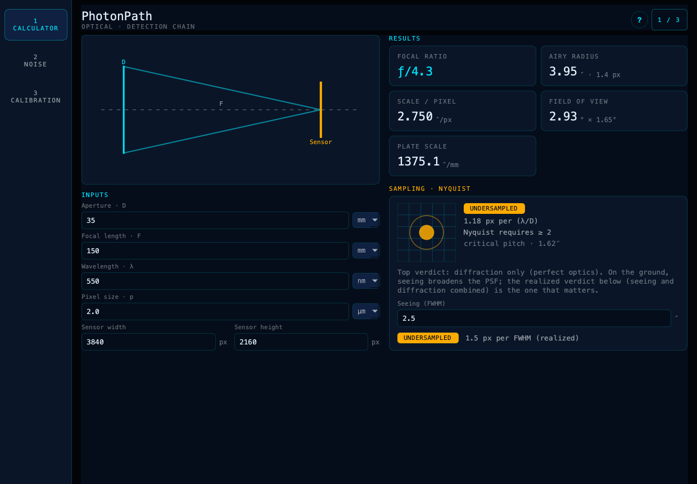
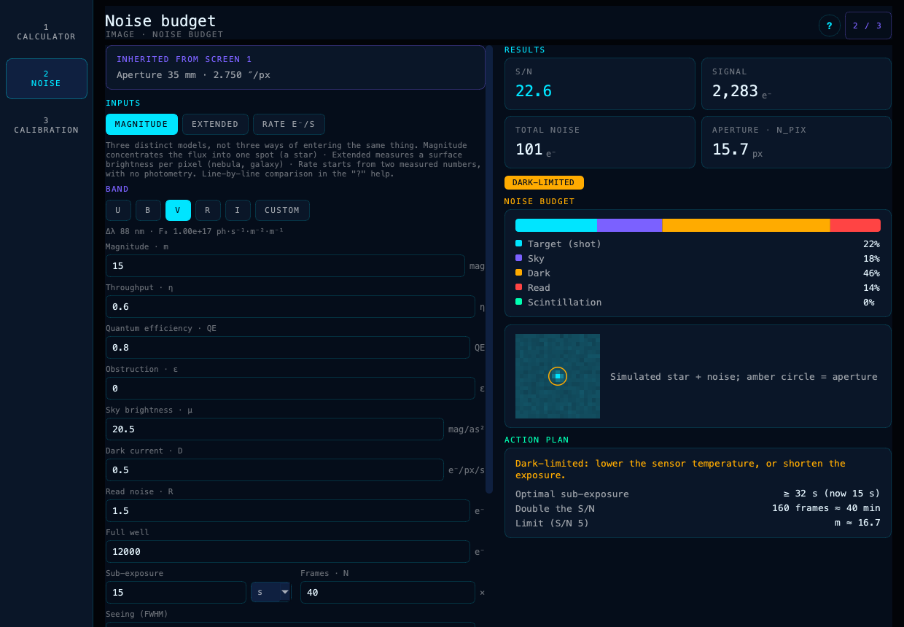
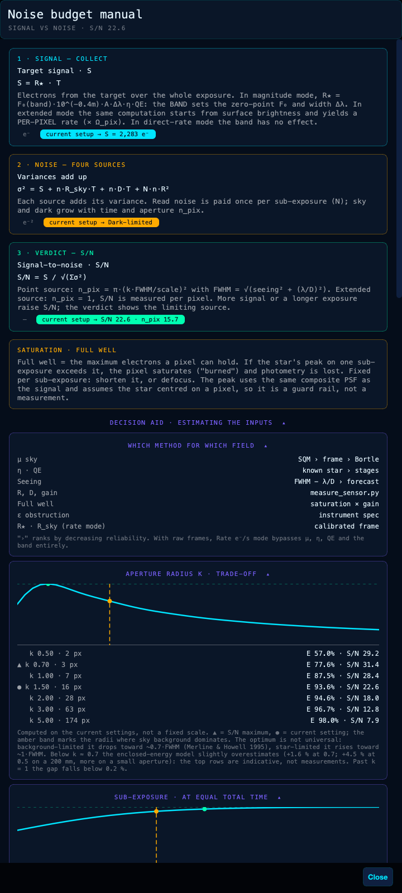
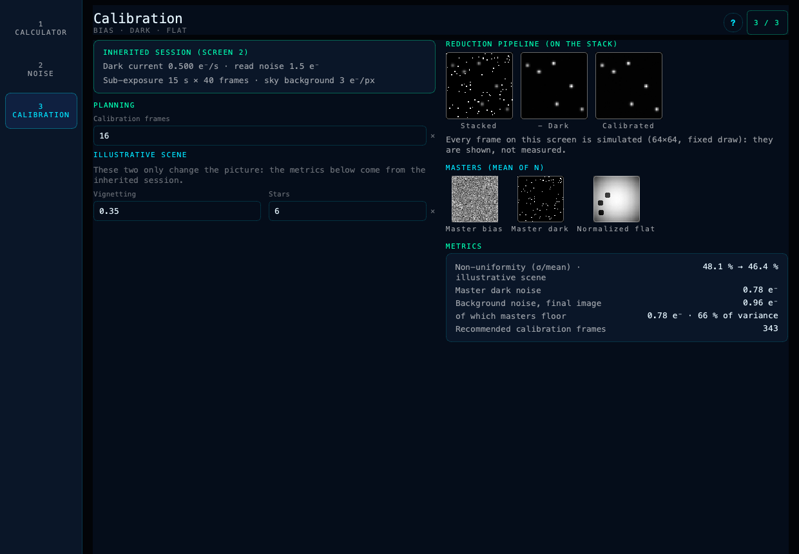

# Tutoriel · Dimensionnement instrumental de bout en bout

> **Français** · [English](TUTORIEL_EN.md) · [Portail interactif hors-ligne (avec switch EN/FR)](index.html) · [Article scientifique](article.html)

L'application s'ouvre par défaut sur la configuration de banc d'essai d'un smart télescope nomade (35/150 mm).
C'est un instrument d'école : sa tache d'Airy dépasse le seeing et son capteur n'est pas refroidi.
Mais la méthode s'applique rigoureusement à **n'importe quel instrument d'observation** (lunette apochromatique, télescope Newton, Schmidt-Cassegrain ou téléobjectif).

Toutes les valeurs ci-dessous sont celles qu'affiche l'application. Changez les
nombres avec les caractéristiques de votre propre matériel : le même parcours méthodique vaut pour tout instrument.

## Étape 0 — Lancer l'application

Installez puis lancez `photonpath` (voir la [documentation](DOCUMENTATION.md#installation-et-lancement)).
L'écran *Calculator* est actif. Rien n'est à saisir pour ce tutoriel.

## Étape 1 — Que voit mon instrument ? (Calculator)



Saisies à l'ouverture : `35 mm / 150 mm / 550 nm / 2.0 µm / 3840 × 2160 px`, seeing `2.5″`.

| Grandeur | Valeur |
|---|---|
| Rapport focal | ƒ/4.3 |
| Rayon d'Airy | 3.95″ · 1.4 px |
| Échelle par pixel | 2.750″/px |
| Champ de vue | 2.93° × 1.65° |
| Diffraction | 1.18 px par λ/D · UNDERSAMPLED |
| Réalisé (seeing 2.5″) | 1.5 px par FWHM · UNDERSAMPLED |

**Lecture.**

- Le pixel (2.75″) est plus large que le pas de Nyquist (λ/2D = 1.62″). L'instrument
  ne rend pas le détail fin, mais il couvre près de 3° × 1.7° d'un coup : c'est un
  instrument de grand champ.
- Particularité : λ/D (3.24″) dépasse le seeing (2.5″), donc les deux verdicts se
  ressemblent. Sur un gros télescope, c'est l'inverse.

> **Essai.** Saisissez un Newton `200 / 1000 mm` avec un pixel de `3.76 µm`.
> L'échelle tombe à 0.776″/px.
>
> - Diffraction : **0.73 px par λ/D → UNDERSAMPLED**.
> - Réalisé, sous 2.5″ de seeing : **3.3 px par FWHM → OVERSAMPLED**.
>
> Le même instrument est sous-échantillonné en théorie et sur-échantillonné en
> pratique : c'est la raison des deux verdicts. Revenez ensuite aux valeurs du DWARF 3.

## Étape 2 — Combien de poses, limité par quoi ? (Noise)



L'écran *Noise* hérite de l'optique. À l'ouverture :

- mode **Magnitude**, étoile `m = 15` en bande V ;
- ciel `μ = 20.5`, η 0.6, QE 0.8 ;
- capteur `D = 0.5 e⁻/s`, `R = 1.5 e⁻`, puits 12 000 ;
- pose `15 s × 40`.

| Grandeur | Valeur |
|---|---|
| S/B | 22.6 |
| Régime | DARK-LIMITED (limité par le capteur) |
| Signal · bruit | 2,283 e⁻ · 101 e⁻ |
| n_pix · E(k) | 15.7 px · 93.6 % |

Le budget de bruit répartit la variance totale entre les sources :

| Cible | Ciel | Obscurité | Lecture | Scintillation |
|---|---|---|---|---|
| 22 % (2 283 e⁻²) | 18 % (1 822) | 46 % (4 698) | 14 % (1 409) | 0 % (désactivée) |

**Plan d'action.**

- Sous-pose optimale : **32 s**. L'actuelle fait 15 s : la lecture compte encore.
- Doubler le S/B demande **160 poses**, soit 40 min.
- Magnitude limite à S/B = 5 : **16.7**.

**Ouverture photométrique.** Ouvrez « ? » → *Decision aid* → *Aperture radius k*.

- Le maximum est vers **k = 0.7**, avec un S/B de **31.4** : +39 % par rapport au
  défaut de 1.5.
- La tache est large et peu concentrée, car λ/D domine. Élargir l'ouverture
  ramasse donc surtout de l'obscurité.



| k | n_pix | E(k) | S/B |
|---|---|---|---|
| 0.5 | 1.7 | 57.0 % | 29.2 |
| 0.7 ▲ | 3.4 | 77.6 % | 31.4 |
| 1.0 | 7.0 | 87.5 % | 28.4 |
| 1.5 ● | 15.7 | 93.6 % | 22.6 |
| 3.0 | 62.6 | 96.7 % | 12.8 |

**Découpage à durée égale (10 min).** La sous-pose conseillée tombe vers
**33 s × 18 poses**, pour un S/B de 23.5 : à peine +4 %. Le découpage n'est pas
l'enjeu ici, car la lecture ne pèse que 14 % de la variance.

**Seeing mesuré ou atmosphérique ?** À 35 mm, saisir la FWHM de vos étoiles au lieu
du seeing le surestimerait de **64 %**. L'omission devient négligeable (moins de 5 %)
à partir de **150 mm** de diamètre.

### Mode Extended — une nébuleuse ou une galaxie

Passez en **Extended**, avec une cible `μ = 21` et un ciel `μ = 20`. Le rayon k et la
scintillation disparaissent : la mesure se fait par pixel.

| Signal /px | Bruit /px | S/B /px · /″² | Variances obscurité · ciel · lecture · cible |
|---|---|---|---|
| 73 e⁻ | 25.5 e⁻ | 2.9 · 1.0 | 300 · 184 · 90 · 73 e⁻² — DARK-LIMITED |

Le capteur non refroidi accumule 300 e⁻² d'obscurité en 10 min, plus que le ciel.
Poser plus longtemps ne change pas le régime : obscurité et ciel croissent tous deux
avec le temps. Le levier est la température du capteur.

### Extinction, scintillation, saturation

- **Extinction :** `k = 0.2`, `X = 1.55` (40° de hauteur) ⇒ Δm = 0.31, soit **25 %**
  de flux perdu.
- **Scintillation** (pastille *+ Atmospheric scintillation*) : **0.71 %** par
  sous-pose de 15 s à 35 mm, contre 0.22 % à 200 mm.
- **Saturation** (scintillation activée, mode Magnitude) :
  - à `m = 6`, le pic atteint **7.5 fois** le puits et la scintillation pèse 92 % de
    la variance ;
  - à `m = 8`, le pic atteint 1.2 fois le puits, et le régime reste
    SCINTILLATION-LIMITED.

  Raccourcir la pose aggrave la scintillation : la vraie sortie est le diamètre, ou
  la hauteur sur l'horizon.

## Étape 3 — Combien de poses de calibration ? (Calibration)



L'écran *Calibration* hérite de la séance de l'écran Noise : `D = 0.5`, `R = 1.5`,
`15 s × 40` et un ciel de **2.91 e⁻** par sous-pose (défauts, mode Magnitude).

| Poses de calibration | Master dark | Bruit final | Part des masters |
|---|---|---|---|
| 16 (défaut) | 0.78 e⁻ | 0.96 e⁻ | 66 % |
| **343 (recommandé)** | 0.17 e⁻ | 0.59 e⁻ | 8 % |

Si vous venez de la séance Extended (ciel `μ = 20`, soit 4.61 e⁻ par sous-pose), la
recommandation tombe à **302** poses : c'est la valeur du tutoriel Android. Dans les
deux cas, c'est le `D = 0.5 e⁻/s` qui se paie une seconde fois. Une nuit froide
allège les deux factures.

Les six vignettes montrent le pipeline (Stacked → − Dark → Calibrated), puis les
masters. Elles sont simulées et ne mesurent rien de votre capteur.

## Étape 4 — Mesurer votre capteur

Les valeurs `D`, `R` et puits du DWARF 3 sont des repères. Mesurez les vôtres au même
gain et à la température d'observation : 2 bias, 2 flats, puis plusieurs darks de
durées croissantes.

L'outil `tools/measure_sensor.py` du dépôt Android fait ce calcul à partir de
fichiers FITS. Son portage dans ce dépôt est une amélioration proposée (lot 9). Côté
Android :

```bash
python tools/measure_sensor.py --self-test
python tools/measure_sensor.py --bias B1.fits B2.fits --flat F1.fits F2.fits \
    --dark 1:D1.fits 5:D5.fits 15:D15.fits 30:D30.fits 60:D60.fits
```

Reportez ensuite `R` et `D`, en électrons, dans l'écran Noise.
